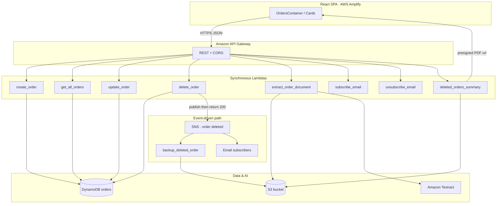

# Serverless AWS Order Management System

> **Keep every order moving.** An event-driven, fully serverless order platform on AWS — React SPA on Amplify, REST APIs on API Gateway + Lambda, DynamoDB for state, S3 for artifacts, SNS for delete alerts, and Amazon Textract for document-driven order intake.

[](https://aws.amazon.com/)
[](https://react.dev/)
[](https://www.typescriptlang.org/)
[](https://vite.dev/)
[](https://vitest.dev/)
[](https://www.python.org/)
[](#license)

| --- | --- |
| **Live demo** | https://main.d8xwpjzf9qbv1.amplifyapp.com |

---

## Table of contents

- [System overview](#system-overview)
- [Architecture](#architecture)
- [Key features](#key-features)
- [Design principles & patterns](#design-principles--patterns)
- [Tech stack](#tech-stack)
- [Repository layout](#repository-layout)
- [API surface](#api-surface)
- [Getting started](#getting-started)
- [CI/CD & scripts](#cicd--scripts)
- [Lambda packaging notes](#lambda-packaging-notes)
- [License](#license)

---

## System overview

This project is an **end-to-end serverless** order-management application. The browser never talks to DynamoDB, S3, or SNS directly — it only calls HTTP APIs. Business rules live in Python Lambdas with a clean handler → service → repository split. Side effects after delete (email + S3 backup) are **asynchronous** via Amazon SNS so the client gets a fast response.

### Primary AWS services

| Service | Role in this system |
| --- | --- |
| **Amazon API Gateway** | RESTful edge: routing, CORS/`OPTIONS`, and Lambda proxy integration |
| **AWS Lambda** | Serverless compute — sync via API Gateway, async via SNS |
| **Amazon DynamoDB** | Low-latency NoSQL store for live orders (`orderId` PK + `createdAt-index` GSI) |
| **Amazon S3** | Deleted-order `.txt` backups, Textract uploads, and generated summary PDFs |
| **Amazon SNS** | Pub/sub bus after delete — email subscribers + `backup_deleted_order` Lambda |
| **Amazon Textract** | OCR on uploaded PDF/PNG/JPEG to prefill `price` and `description` |
| **AWS Amplify** | Hosting + CI/CD for the React SPA (`amplify.yml` → `npm run validate` → `build`) |

---

## Architecture



### Delete flow (why it stays fast)

```text
Client                API Gateway           delete_order              SNS
  |  DELETE /orders/{id}  |                      |                     |
  |---------------------->|--------------------->|                     |
  |                       |   1. Delete item     |                     |
  |                       |   2. Publish event   |-------------------->|
  |                       |   3. Return 200      |                     |
  |<----------------------|<---------------------|                     |
  |                       |                      |     (async)         |
  |                       |                      |   + email fans-out  |
  |                       |                      |   + backup Lambda   |
  |                       |                      |     writes S3 .txt  |
```

---

## Key features

- **Order CRUD** — create, list (sorted by creation date), update, and delete via REST
- **Document intake** — upload a PDF/PNG/JPG; Textract extracts `price` and `description` into the form
- **Async delete side effects** — SNS fans out email notifications and an S3 text backup without blocking the API response
- **Subscription management** — subscribe / unsubscribe emails to the order-deleted SNS topic
- **Deleted-orders PDF report** — Lambda reads backup `.txt` files, writes a PDF to S3, returns a download URL for the UI
- **Typed React client** — Axios services + `src/types/*` contracts; UI only displays API results (no cloud SDKs in the browser)

---

## Design principles & patterns

### Backend (Python / Lambda)

Lambdas follow **Clean Architecture** with clear layers:

```text
lambda_function.py     → HTTP/event adapter (thin)
services/              → business rules (no boto3)
repositories/          → DynamoDB / S3 persistence
publishers/ | clients/ → SNS / Textract adapters
```

| Principle / pattern | How it shows up |
| --- | --- |
| **SRP** | Handlers parse events; services validate and orchestrate; repositories own I/O |
| **Composition over inheritance** | Services receive collaborators in `__init__` — no deep class hierarchies |
| **Dependency injection** | `OrderService(OrderRepository(), OrderDeletedPublisher())` at module scope for warm reuse, still swappable in tests |
| **Repository pattern** | DynamoDB/`put_item`/`query`/`delete` hidden behind `OrderRepository` |
| **Adapter pattern** | Thin wrappers around boto3 (`TextractClient`, SNS publisher, S3 helpers) |
| **Testability first** | Inject fakes/mocks for storage and AWS clients — unit tests do not need live AWS credentials |

### Frontend (React / TypeScript)

- **`OrdersContainer`** owns list state: one fetch on mount, then local updates after create / update / delete to avoid extra DynamoDB reads
- **Types live in `src/types/`** (`order.ts`, `subscription.ts`, `report.ts`) — services import contracts; they never define them (see `.cursor/skills/rules/frontend.mdc`)
- **Thin services** — Axios + `VITE_API_BASE_URL` only; components handle UX, loading, and errors via `getApiErrorMessage`

---

## Tech stack

| Layer | Technologies |
| --- | --- |
| **Frontend** | React 19, TypeScript, Vite 6, Tailwind CSS 4, Axios |
| **Backend** | Python 3.12+, AWS Lambda, boto3, fpdf2 (PDF summaries) |
| **Cloud** | API Gateway, DynamoDB, S3, SNS, Textract, Amplify Hosting |
| **Testing & quality** | Vitest, Testing Library, ESLint, Prettier, `tsc --noEmit` |
| **DevOps** | `amplify.yml` CI (`npm ci` → `npm run validate` → `npm run build`) |

---

## Repository layout

```text
.
├── amplify.yml                 # Amplify appRoot: frontend
├── backend/
│   └── lambdas/
│       ├── create_order/
│       ├── get_all_orders/
│       ├── update_order/
│       ├── delete_order/
│       ├── backup_deleted_order/      # SNS subscriber
│       ├── subscribe_email/
│       ├── unsubscribe_email/
│       ├── extract_order_document/    # Textract
│       └── deleted_orders_summary/    # PDF report
└── frontend/
    ├── .env.example
    ├── package.json
    └── src/
        ├── components/
        ├── services/
        ├── types/
        ├── utils/
        └── tests/
```

---

## API surface

| Method | Path | Lambda | Notes |
| --- | --- | --- | --- |
| `POST` | `/orders` | `create_order` | Body: `{ price, description }` → **201** |
| `GET` | `/orders` | `get_all_orders` | Sorted by `createdAt` |
| `PUT` | `/orders/{orderId}` | `update_order` | Updates price/description |
| `DELETE` | `/orders/{orderId}` | `delete_order` | Publishes SNS, returns immediately |
| `POST` | `/documents` | `extract_order_document` | `{ fileName, contentBase64 }` → `{ price, description }` |
| `POST` | `/subscriptions/subscribe` | `subscribe_email` | `{ email }` |
| `POST` | `/subscriptions/unsubscribe` | `unsubscribe_email` | `{ email }` |
| `GET` | `/deleted-orders/summary` | `deleted_orders_summary` | `{ url }` presigned PDF |

> Confirm path names in your API Gateway stage match the client (`frontend/src/services/*`). Enable CORS and an `OPTIONS` route for the Amplify origin.

---

## Getting started

### Prerequisites

- Node.js 20+ and npm
- An AWS account (Learner Lab / IAM user with permissions for the services above)
- API Gateway stage already wired to the Lambdas
- Python 3.12+ (only needed to re-package Lambdas)

### Frontend environment

```bash
cd frontend
cp .env.example .env
```

Set your invoke URL (no trailing slash):

```env
VITE_API_BASE_URL=https://xxxxxxxxxx.execute-api.region.amazonaws.com/dev
```

### Install & run the SPA

```bash
cd frontend
npm ci
npm run dev
```

Open the Vite URL (typically `http://localhost:5173`).

### Run frontend quality gates

```bash
cd frontend
npm run validate   # lint + type-check + vitest + prettier --check
```

### Backend (Lambda) setup sketch

1. Zip each folder under `backend/lambdas/<function>/` (handler: `lambda_function.lambda_handler`).
2. Attach the shared response layer that provides `build_response` where used.
3. Configure environment variables per function, for example:

| Function | Environment variables |
| --- | --- |
| `create_order` / `get_all_orders` / `update_order` / `delete_order` | `ORDERS_TABLE_NAME` |
| `delete_order` / `subscribe_email` / `unsubscribe_email` | `ORDER_DELETED_TOPIC_ARN` |
| `backup_deleted_order` | `DELETED_ORDERS_BUCKET` |
| `deleted_orders_summary` | `DELETED_ORDERS_BUCKET`, `DELETED_ORDERS_PREFIX` |
| `extract_order_document` | `TEXTRACT_BUCKET` |

4. Subscribe `backup_deleted_order` to the same SNS topic used by `delete_order`.
5. Point API Gateway routes at the sync Lambdas; grant least-privilege IAM roles.

Backend modules are structured for **mock-injected unit tests** (repositories/clients passed into services). Add `pytest` locally as you expand coverage — no live AWS credentials are required for pure unit tests.

---

## CI/CD & scripts

### Amplify pipeline

`amplify.yml` at the repo root configures a monorepo-style app:

1. `appRoot: frontend`
2. **preBuild:** `npm ci`
3. **build:** `npm run validate` then `npm run build`
4. **artifacts:** `frontend/dist`

A failed lint, type-check, test, or Prettier check **blocks** the deploy.

### Frontend npm scripts

| Command | Purpose |
| --- | --- |
| `npm run dev` | Vite development server |
| `npm run build` | `tsc -b` + production bundle |
| `npm run preview` | Serve the production build locally |
| `npm run lint` | ESLint |
| `npm run type-check` | TypeScript without emit |
| `npm run test` / `npx vitest` | Vitest unit/integration tests |
| `npm run test:watch` | Vitest watch mode |
| `npm run format` | Prettier **check** (CI-safe; does not rewrite) |
| `npx prettier --write .` | Format files in place locally |
| `npm run validate` | lint → type-check → test → format check |

### Conventional commits

Prefer structured messages so history stays reviewable:

```text
feat(frontend): add deleted-orders PDF report card
fix(delete): return 404 when order is missing
refactor(services): move API types into src/types
chore(ci): add amplify.yml quality gates
```

---

## Lambda packaging notes

- Handler path: `lambda_function.lambda_handler`
- For `deleted_orders_summary`, install `fpdf2` **into** the function folder before zipping (see `.gitignore` vendored paths)
- Keep Textract uploads under a dedicated prefix (e.g. `textract-uploads/`), separate from `deleted-orders/`
- Summary PDFs are written under `summaries/` and exposed via a time-limited presigned URL

---

## License

MIT — use, learn from, and extend freely for coursework and demos.
